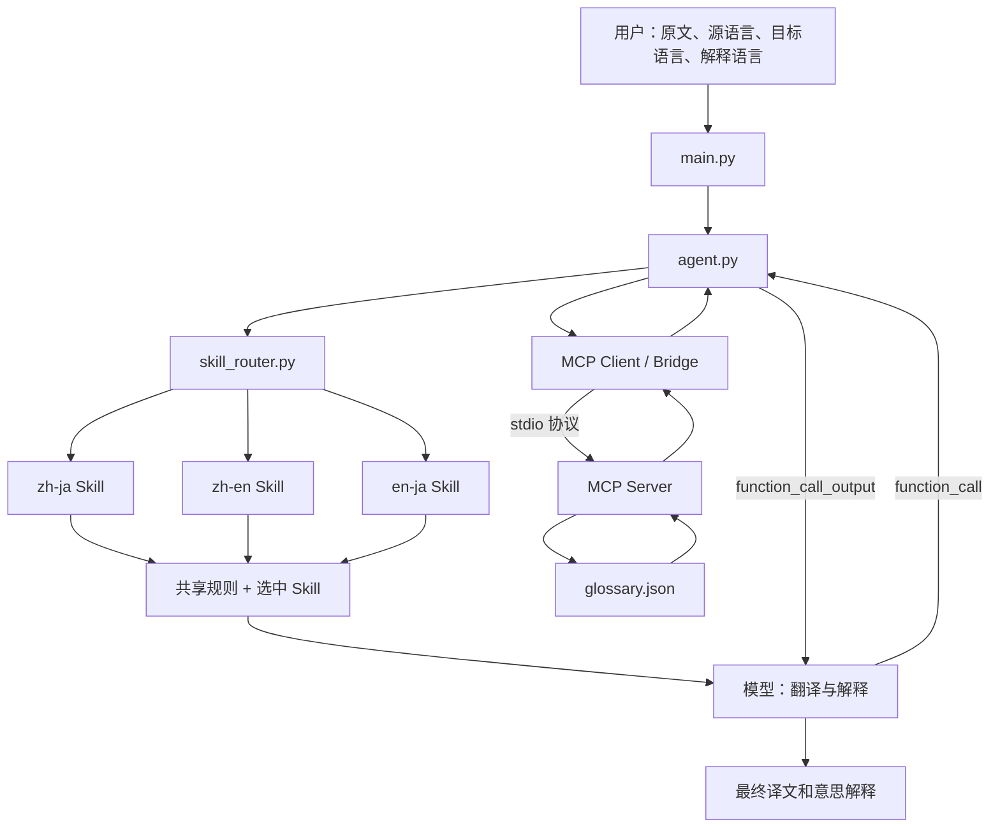

# 中日英翻译 Agent：Skills + MCP 完整最小示例

一个 Python 命令行项目，演示 **一个 Agent 根据语言方向加载三个 Skill 之一，再通过真实 MCP 查询术语，并调用模型完成翻译和意思解释**。

| 组件 | 本项目中的实现 | 解决的问题 |
|---|---|---|
| Agent | `agent.py` | 组织指令、调用模型、执行工具、回传结果、结束任务 |
| Skills | `skills/zh-ja`、`zh-en`、`en-ja` | 不同语言组合各自需要哪些翻译和解释规则 |
| MCP Client | `mcp_bridge.py` | 与本地 MCP Server 通信，并适配模型工具格式 |
| MCP Server | `mcp_server.py` | 提供 `lookup_term` 查询工具 |
| 知识数据 | `data/glossary.json` | 维护固定表达和术语的候选译法、注意事项 |

**两个运行模式：**

- 正常模式：调用 OpenAI Responses API，生成译文和意思解释。需要你自己的 API 密钥和模型权限。
- `--demo`：加载真实 Skill，启动真实 MCP 子进程并查询术语，不调用模型、不生成翻译，适合先验证环境。

## 1. 框架结构

```text
Test-Agent-Skill-MCP/
├── main.py                   # 命令行入口、环境配置、错误提示
├── agent.py                  # 请求校验、Skill 加载、模型与工具循环
├── skill_router.py           # 六个方向映射到三个 Skill
├── mcp_bridge.py             # MCP 生命周期及 Responses 工具适配
├── mcp_server.py             # FastMCP 术语服务，stdio 通信
├── requirements.txt          # 运行依赖
├── requirements-dev.txt      # Skill 格式校验的可选开发依赖
├── .env.example              # 密钥和模型配置示例
├── .gitignore
├── skills/
│   ├── common.md             # 共享输出格式、忠实原意等规则
│   ├── zh-ja/SKILL.md        # 中文 ↔ 日文
│   ├── zh-en/SKILL.md        # 中文 ↔ 英文
│   └── en-ja/SKILL.md        # 英文 ↔ 日文
├── data/glossary.json        # 小型教学术语表
├── tests/test_agent.py       # 离线模型替身 + 真实 MCP 集成验证
└── docs/
    ├── walkthrough.md       # 代码级详细说明
    ├── examples.md          # 六个方向的命令与预期观察结果
    └── validation.md        # 本次验证范围及结果
```



Skill 以文本指令进入模型上下文。它不是独立模型，也不是调用后会自动执行的函数。MCP 是本地 Client 与 Server 之间的协议；模型 API 不会直接访问本机 stdio Server。

## 2. 安装

需要 **Python 3.11 或更高版本**，建议使用 Python 3.12。

### Windows PowerShell

```powershell
git clone https://github.com/chunyuhan0618-svg/Test-Agent-Skill-MCP.git
cd Test-Agent-Skill-MCP
py -3.12 -m venv .venv
.\.venv\Scripts\python.exe -m pip install -r requirements.txt
```

后续命令使用 `python` 时，请替换为 `.\.venv\Scripts\python.exe`，或先激活虚拟环境。直接使用解释器路径不需要更改 PowerShell 执行策略。

### macOS / Linux

```bash
git clone https://github.com/chunyuhan0618-svg/Test-Agent-Skill-MCP.git
cd Test-Agent-Skill-MCP
python3 -m venv .venv
source .venv/bin/activate
python -m pip install -r requirements.txt
```

本教学代码固定使用 MCP Python SDK **1.26.0** 的 `FastMCP` / `ClientSession` 接口。请先安装仓库指定版本；升级到其他主版本需要重新核对接口，不要仅复制旧代码后安装任意版本。

## 3. 先运行无需密钥的演示

```powershell
.\.venv\Scripts\python.exe main.py --text "お疲れ様です。ご確認をお願いいたします。" --source ja --target zh --demo --verbose
```

你会看到：

```text
[skill] selected=zh-ja
[mcp] initialized; discovered=lookup_term
```

然后输出 JSON：`selected_skill` 是 `zh-ja`，`mcp_result.found` 为 `true`，命中 `otsukaresama` 和 `review-request`。这是真实 MCP 查询结果，**不是模型翻译结果**。

Server 由程序自动启动和关闭，不用再开终端运行它。直接运行 `python mcp_server.py` 时，它会等待协议输入，看起来像“没反应”，这是正常现象。

## 4. 配置并运行真实翻译

PowerShell：

```powershell
Copy-Item .env.example .env
```

macOS / Linux：

```bash
cp .env.example .env
```

编辑 `.env`：

```dotenv
OPENAI_API_KEY=你的真实API密钥
OPENAI_MODEL=gpt-4.1-mini
```

模型名称是可替换的示例。使用自己账号中可用且支持 Responses API、function calling 的模型。正常模式会向 OpenAI 发送原文、选中的 Skill 和工具结果，并产生相应 API 用量；`store=False` 不等同于所有平台数据保留政策都被关闭。不要提交 `.env`。

```powershell
.\.venv\Scripts\python.exe main.py --text "お疲れ様です。ご確認をお願いいたします。" --source ja --target zh --explain zh --verbose
```

正常模式预期包含以下四部分，具体措辞由模型生成：

```text
译文：您好，麻烦您确认一下。
意思解释：礼貌地请对方查看或核实相关内容。
关键词与用法：解释职场寒暄及请求的礼貌程度。
术语参考：说明本次实际命中的词条及语境限制。
```

这段是说明性输出示意，不是已录制的线上模型执行结果。

## 5. 参数

| 参数 | 是否必填 | 说明 |
|---|---|---|
| `--text` | 是 | 原文，1～10000 个字符 |
| `--source` | 是 | `zh`、`ja`、`en` |
| `--target` | 是 | `zh`、`ja`、`en`，必须不同于源语言 |
| `--explain` | 否 | 解释语言，默认 `zh`，独立于翻译方向 |
| `--demo` | 否 | 只验证 Skill + 真实 MCP，不调用模型 |
| `--verbose` | 否 | 在 stderr 显示加载及调用日志，包含原文和查询结果 |

第一版明确指定源语言，避免短文本或纯汉字文本自动识别错误。`en → ja`、中文解释时依然加载 `en-ja`，不会加载 `zh-ja`。

## 6. Agent 如何使用 Skill 和 MCP

1. 校验请求，将源语言和目标语言组成一个无序集合。
2. 加载对应一个 `SKILL.md` 和共享 `common.md`。
3. 通过当前 Python 解释器启动 MCP Server 子进程，完成初始化并发现工具。
4. 将工具的名称、说明、JSON Schema 转换为 Responses API 的 function 定义。
5. 发送 Skill 指令和翻译请求。**首轮强制调用 `lookup_term`**，让教学过程一定能观察到 MCP。
6. 收到模型 `function_call` 后，校验工具名称和翻译方向，经 MCP 执行查询。
7. 用相同 `call_id` 回传 `function_call_output`，保留完整历史（包括推理项）。
8. 模型可以继续查询或生成答案；最多调用模型 5 轮，每次 API 请求允许一次 SDK 重试。

详细解释见 [代码导读](docs/walkthrough.md)，六向命令见 [运行示例](docs/examples.md)。

## 7. 验证

```powershell
.\.venv\Scripts\python.exe -m unittest discover -s tests -v
```

测试覆盖六向路由、真实 MCP 子进程查询、未命中、无效参数、工具结果回传、未知工具、方向错误、轮数限制、响应不完整、演示模式和缺少配置。模型输出由替身提供，不消耗 API；因此这些测试不证明线上模型可用性或翻译质量。实际翻译验收需要配置自己的密钥后运行正常模式。

还包含使用真实 OpenAI SDK、本地 HTTP 响应替身和真实 MCP 的契约测试，验证工具定义、模型响应解析和历史序列化。已执行结果见 [验证记录](docs/validation.md)。

## 8. 常见问题

| 问题 | 处理 |
|---|---|
| 提示缺少 `mcp` / `openai` | 使用安装依赖时的同一个虚拟环境解释器运行 |
| 演示成功，正常模式失败 | 检查 API 密钥、网络、模型名称和账号权限 |
| 401 / 429 / 模型不存在 | 分别检查认证、额度或速率限制、模型访问权限 |
| 术语未命中 | 正常情况；模型仍可翻译；小词表不是完整词典 |
| 首轮总是调用工具 | 教学设计；可将 `tool_choice` 改为 `auto` 观察自主查询 |
| 同语言输入报错 | 本例处理跨语言翻译；尚未实现同语言润色 |
| 日文输出乱码 | 使用支持 UTF-8 的终端；必要时用 `python -X utf8 main.py ...` |
| 出现 `IncompleteFieldDefinitionWarning: lifespan` | 本次依赖组合下 MCP 的设置模型触发该警告，演示和测试均通过；它不是术语查询失败 |

## 9. 官方参考

- [OpenAI function calling](https://developers.openai.com/api/docs/guides/function-calling)：本例工具调用及结果回传的接口依据。
- [MCP Python SDK 1.26.0](https://github.com/modelcontextprotocol/python-sdk/tree/v1.26.0)：本例固定版本的代码参考。
- [Agent Skills 格式](https://agentskills.io/specification)：`SKILL.md` 的基础组织方式。本项目自行实现路由和文本加载，不依赖客户端内置发现机制。
